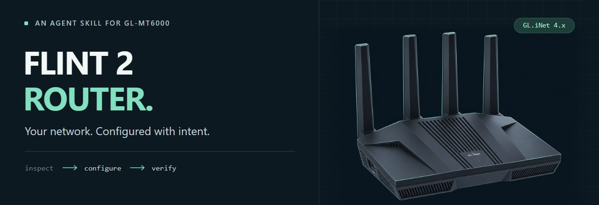

<p align="center">
  
</p>

<p align="center">
  <strong>A practical agent skill for the router that runs your network.</strong><br>
  SSH workflows. Current official sources. Recovery before disruption.
</p>

<p align="center">
  <a href="LICENSE"></a>
  
  
  
</p>

<p align="center">
  <a href="#what-it-does">Capabilities</a> ·
  <a href="#get-started">Get started</a> ·
  <a href="#try-it">Example requests</a> ·
  <a href="#how-it-works">How it works</a> ·
  <a href="#validation">Validation</a>
</p>

---

## What it does

`skill-flint2-router` helps a capable coding agent configure and troubleshoot **Flint 2 (GL-MT6000) running GL.iNet 4.x**. It starts with your actual firmware and current configuration, looks up the relevant official guide, and carries out the change you requested with an appropriate recovery and verification plan.

It is an Agent Skills package: instructions, focused references, and two small optional helpers. Your agent supplies the shell, SSH access, and documentation tools.

| Network task | What the skill pays attention to |
| --- | --- |
| **Wi-Fi & clients** | Actual radio/interface names, security, client identity, DHCP reservations, and reconnection |
| **LAN, WAN & segmentation** | Address conflicts, physical port mapping, VLANs, guest/IoT boundaries, IPv6, and Multi-WAN |
| **VPN & routing** | WireGuard/OpenVPN, selected clients, DNS paths, per-tunnel kill switches, and failure behavior |
| **DNS & applications** | AdGuard Home, encrypted DNS, Tailscale/ZeroTier, service ownership, and resolver loops |
| **Security & performance** | Firewall backend, admin exposure, SQM/QoS trade-offs, acceleration, and measured outcomes |
| **Maintenance & recovery** | Scoped backups, access-changing operations, firmware-specific procedures, and honest completion checks |

The wider shared interface is covered through a searchable official source catalog. Hardware support and firmware applicability are checked for each task.

> **Version-aware by design.** GL.iNet 4.x spans different interfaces and underlying builds. A guide for one release, a generic OpenWrt command, or an option shown for another model is not enough to justify a write on your router.

## Get started

### 1. Review the package

Start with [SKILL.md](SKILL.md), [the access reference](references/access-and-discovery.md), and [SECURITY.md](SECURITY.md). Review scripts before enabling them in your agent environment. Installing a skill gives it instructions; your runtime's permission controls still govern tool access and execution.

The core instructions need no Python packages. The optional helpers require **Python 3.10+**. Router inspection also needs **OpenSSH**, an existing trusted router host key, and working key authentication. Password-only access can use ordinary interactive SSH instead.

### 2. Add it to your agent

Place a reviewed copy of this repository at the appropriate skill location, preserving `SKILL.md`, `references/`, and `scripts/`. Use your runtime's normal review/installation process; preserve existing files when a destination already exists.

| Agent | Discovery and requirements |
| --- | --- |
| **Codex** | Personal package: `~/.codex/skills/skill-flint2-router/`. Includes optional `agents/openai.yaml` UI metadata. Invoke `$skill-flint2-router` or let normal skill discovery select it. |
| **Claude Code** | Personal package: `~/.claude/skills/skill-flint2-router/`; project package: `.claude/skills/skill-flint2-router/`. Invoke `/skill-flint2-router` through Claude's native skill mechanism. |
| **Antigravity** | Use the skill directory documented by your installed IDE/CLI version. The portable Markdown/CLI core has no Gemini-specific dependency. Verify discovery in that installation. |
| **Hermes** | Use its native reviewed skill installer/category and verify discovery. No Hermes-specific tool names or lifecycle hooks are required by the core. |

These are **intended integration paths**, not a claim that every runtime or live router has been tested. Shell, SSH, web tools, credentials, and permissions must be available independently in each environment. No MCP server is required.

### 3. Give it a concrete outcome

For Codex, for example:

```text
Use $skill-flint2-router. My router is at <router-address>.
Inspect the model and firmware, then reserve <client-address> for
<client-MAC>. Preserve existing reservations and verify the result.
```

Supply the existing router address and intended outcome. Keep admin passwords, Wi-Fi passwords, VPN keys, and full configuration exports out of prompts and issues.

## Try it

**A work laptop with a fail-closed VPN**

```text
Route only my work laptop through the existing WireGuard tunnel.
If that tunnel fails, block the laptop's internet. Other devices should
keep using WAN. Check DNS and IPv6 behavior too.
```

**An isolated IoT network**

```text
Put the devices on one specified LAN port into an isolated IoT subnet.
Keep internet, DHCP and DNS working, block access to the main LAN and
router administration, and prepare recovery before changing ports.
```

**Lower latency during a busy connection**

```text
Investigate gaming latency under load. Check SQM, QoS and acceleration
for my installed firmware. This is a metered connection: use existing
measurements and do not run a speed test.
```

**Diagnose before changing**

```text
AdGuard Home is enabled, but some clients appear to bypass it.
Trace the DNS path and explain the evidence. This task is read-only.
```

## How it works

```text
 Your goal      Actual router       Matching source       Scoped change
    ──────▶  model · build · state  ──────▶  official guide  ──────▶  verify
                                                              recovery ready
```

1. **Identify.** Confirm the device, GL.iNet version, underlying build, available tools, and management route.
2. **Look up.** Load one focused reference and fetch the applicable official documentation.
3. **Prepare.** Establish the current state, intended diff, affected clients, and recovery for disruptive operations.
4. **Apply.** Execute clearly authorized changes through a verified SSH mapping or supported admin interface.
5. **Verify.** Check persistent settings, effective behavior, affected and unaffected clients, and relevant failure paths.

The skill does not guess private RPC methods or treat a successful command as proof of a working network. If a firmware-specific execution mapping is missing, it explains the gap and uses the supported UI route when available.

### Small entrypoint, useful references

```text
skill-flint2-router/
├── SKILL.md                    Agent entrypoint
├── agents/openai.yaml          Optional Codex metadata
├── references/                 Focused operating guidance + source catalog
├── scripts/                    Two dependency-free Python helpers
├── tests/                      Offline helper and package checks
└── repository-docs/            Design, plan, and validation evidence
```

The [official source catalog](references/official-docs.json) initially covers **87 fetched pages**, including **82 Interface Guide URLs** with historical/version variants. It stores links and provenance, not a bundled copy of the manuals. See [documentation routing](references/documentation.md) for selection and refresh rules.

### Optional helpers

Run these from the skill directory. `router.example` is a placeholder for your actual selected router.

```sh
# Inspect the exact SSH arguments and fixed read-only script without connecting.
python scripts/inspect_router.py --host router.example --dry-run

# Collect a small hardware/firmware/tool inventory through existing trusted SSH.
python scripts/inspect_router.py --host router.example

# Fetch public documentation metadata into a new, ignored candidate file.
python scripts/refresh_docs.py --output .local/official-docs.candidate.json
```

The inventory helper makes no configuration changes and caps captured SSH output. The refresher contacts only the official documentation host, respects robots rules, bounds requests, rejects redirects for canonical-source review, and refuses to overwrite an existing output. Neither helper calls an LLM, installs router packages, or replaces the maintained catalog automatically.

## Validation

The repository includes offline tests for SSH argument safety, host-key settings, output privacy, firmware/model rejection, documentation scope/completeness, and packaging. Run:

```sh
python -B -m unittest discover -s tests -v
```

The CI workflow is configured to run the offline suite on Linux and Windows. Its result tests the package; it does not certify router firmware or network isolation. See [validation evidence and limitations](repository-docs/validation.md) for the release's actual checks, behavioral evaluations, and static security review.

**Live-router execution and runtime-loader compatibility require separate verification in the target environment.** No real router changes are needed to run the repository tests.

## Contributing

Useful contributions include verified firmware-specific mappings, reproducible sanitized failures, and better recovery/verification workflows. Start with [CONTRIBUTING.md](CONTRIBUTING.md). For security concerns, read [SECURITY.md](SECURITY.md) before posting details.

## License & attribution

[MIT](LICENSE) for this repository's original code, instructions, and artwork. Vendor manuals and third-party software retain their own rights; see [NOTICE.md](NOTICE.md).

An independent community project. Not affiliated with or endorsed by GL.iNet. Flint 2 and GL.iNet names identify the hardware and firmware this skill supports.
